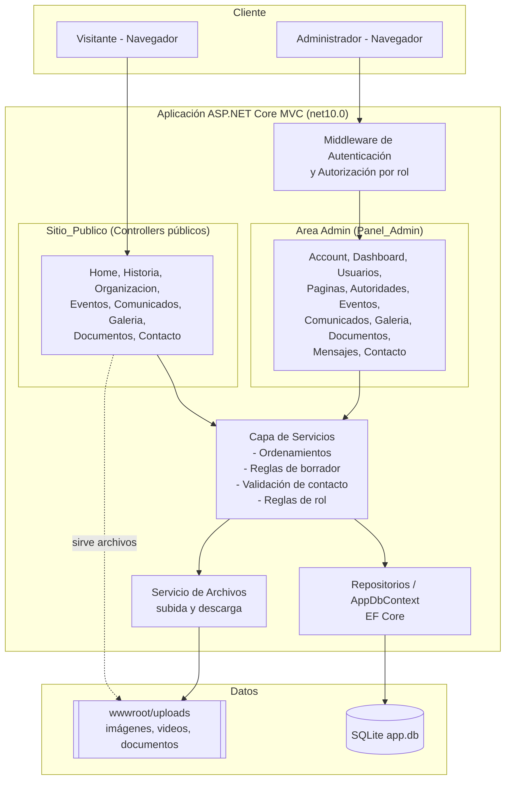
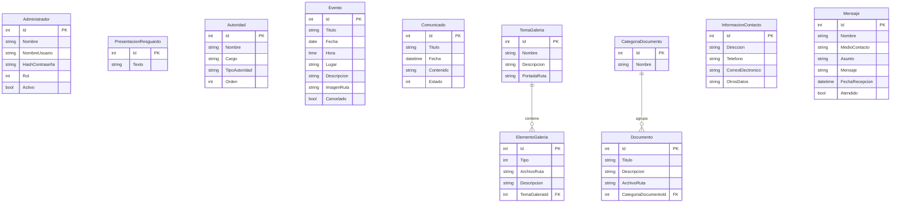

# Design Document

## Overview

Este documento describe el diseño técnico del sitio web del Resguardo Indígena Rincón Bodega, correspondiente a un **boceto funcional**. El objetivo es definir una arquitectura clara y suficiente para implementar el comportamiento especificado en `requirements.md`, sin abordar los temas excluidos del alcance (seguridad avanzada, rendimiento, accesibilidad, diseño visual, despliegue, entre otros).

El sistema es una aplicación **ASP.NET Core MVC (net10.0)** con dos grandes bloques funcionales:

- **Sitio_Publico**: páginas abiertas a cualquier Visitante (inicio, historia, organización, eventos, comunicados, galería, documentos y contacto). Cubre los Requisitos 1–17.
- **Panel_Admin**: pantallas protegidas por autenticación, donde Administrador_General y Editor gestionan el contenido y las cuentas. Cubre los Requisitos 18–43.

El Panel_Admin se implementa como un **Area de MVC** (`Areas/Admin`), lo que aísla sus controladores, vistas y rutas del sitio público y permite aplicar autorización de forma uniforme a toda esa zona.

Decisiones de diseño principales (justificadas por tratarse de un boceto funcional):

- **Persistencia con Entity Framework Core + SQLite**: base de datos en un único archivo, sin servidor ni instalación adicional. Es simple de arrancar y suficiente para validar el comportamiento. El proveedor puede sustituirse después (por ejemplo, SQL Server o PostgreSQL) cambiando solo la configuración del `DbContext` (Requisitos de persistencia implícitos en los módulos de gestión).
- **Autenticación mínima basada en cookies**: ASP.NET Core Cookie Authentication con *claims* de rol. Cubre el inicio/cierre de sesión y la autorización por rol (Requisitos 18–23) sin introducir políticas de contraseña, bloqueo ni expiración de sesión (fuera de alcance).
- **Arquitectura en capas**: Controllers → Services → Repositories/DbContext → almacén de datos, para separar la lógica de negocio (ordenamientos, validaciones, reglas de rol) de la infraestructura web y facilitar las pruebas.

### No-Objetivos de este diseño

Los siguientes puntos están **fuera de alcance** y no se diseñan aquí (coinciden con la sección "Alcance y No-Objetivos" de los requisitos):

- Seguridad avanzada: HTTPS/TLS, cifrado, protección frente a ataques, **políticas de contraseña**, bloqueo de cuenta, **expiración de sesión** y *hardening* de cookies.
- Atributos no funcionales: rendimiento, accesibilidad, compatibilidad, copias de seguridad y disponibilidad.
- Diseño visual: CSS, colores, tipografía y diseño responsivo (se harán manualmente después).
- Multilenguaje: el sitio opera solo en español.
- Funciones adicionales: recuperación de contraseña, historial de auditoría, notificaciones y programación de publicaciones.
- Despliegue: hospedaje, dominio y capacitación.

Donde el diseño incluye *hashing* de contraseñas se usa un componente estándar (`PasswordHasher<TUser>`), pero **no** se definen políticas de contraseña ni mecanismos de bloqueo o caducidad.

## Architecture

### Visión general en capas

La aplicación sigue una arquitectura en capas dentro del mismo proyecto MVC:

- **Capa de presentación (Controllers + Views)**: recibe peticiones HTTP, valida el `ModelState`, invoca servicios y devuelve vistas o archivos. Se divide en controladores públicos y controladores del Area Admin.
- **Capa de servicios (Services)**: contiene la lógica de negocio: ordenamientos (eventos próximos primero, comunicados y mensajes del más reciente al más antiguo), reglas de visibilidad de borradores, transiciones de estado de comunicados, validación del medio de contacto y reglas de rol para eliminar contenido.
- **Capa de acceso a datos (Repositories + DbContext)**: encapsula las operaciones sobre EF Core. El `AppDbContext` define los `DbSet` de cada entidad.
- **Almacén de datos**: base de datos SQLite (`app.db`) para los datos estructurados y el sistema de archivos (`wwwroot/uploads`) para imágenes, videos y documentos.

Transversalmente, el **middleware de autenticación/autorización** protege el Area Admin, y el **manejo de archivos** (subida y descarga) se apoya en `IWebHostEnvironment` para resolver rutas físicas.

### Diagrama de componentes



### Flujo de autenticación del Panel_Admin

1. El Administrador envía usuario y contraseña al `AccountController` (Area Admin).
2. El servicio de autenticación busca la cuenta por `NombreUsuario`, verifica que esté `Activo` y valida la contraseña con `PasswordHasher`.
3. Si es válida, se emite una cookie de autenticación con *claims* de identidad y de rol (`Administrador_General` o `Editor`) y se redirige al Dashboard (Requisito 18.1).
4. Si es inválida o la cuenta está inactiva, se mantiene en la pantalla de inicio de sesión con un mensaje de credenciales incorrectas (Requisitos 18.2, 22.2).
5. Cualquier acceso no autenticado a una ruta del Area Admin es redirigido al inicio de sesión por el middleware, sin exponer la pantalla solicitada (Requisito 18.3).

### Configuración en `Program.cs`

Al diseño actual (`AddControllersWithViews()`) se añaden:

- `AddDbContext<AppDbContext>(opt => opt.UseSqlite(...))` con la cadena de conexión a SQLite desde `appsettings.json`.
- `AddAuthentication(CookieAuthenticationDefaults.AuthenticationScheme).AddCookie(...)` con `LoginPath = "/Admin/Account/Login"`.
- `AddAuthorization(...)` con una política `"GestionCuentas"` y una política `"EliminarContenido"` que exigen el rol `Administrador_General`.
- Registro de servicios y repositorios por inyección de dependencias.
- Mapeo de rutas de Area (`MapControllerRoute` para `areas`) además de la ruta por defecto.
- Middleware en orden: `UseStaticFiles` → `UseRouting` → `UseAuthentication` → `UseAuthorization`.

## Components and Interfaces

### Controladores del Sitio_Publico

| Controlador | Acciones principales | Requisitos |
|-------------|----------------------|------------|
| `HomeController` | `Index` (presentación + accesos + últimos eventos y comunicados) | 1, 2 |
| `HistoriaController` | `Index` (texto de Presentacion_Resguardo) | 3 |
| `OrganizacionController` | `Index` (autoridades/cargos/comités ordenados) | 4 |
| `EventosController` | `Index` (lista ordenada), `Detalle(id)` | 5, 6, 7 |
| `ComunicadosController` | `Index` (solo publicados, recientes primero), `Detalle(id)` | 8, 9, 32.3 |
| `GaleriaController` | `Index` (temas + portada), `Tema(id)`, `Foto(id)` | 10, 11, 12 |
| `DocumentosController` | `Index` (agrupados por categoría), `Descargar(id)` | 13, 14 |
| `ContactoController` | `Index` (info + formulario), `Enviar(modelo)` [HttpPost] | 15, 16, 17 |

Todos los controladores públicos comparten el menú de navegación a través del layout (Requisito 2).

### Controladores del Area Admin (`Areas/Admin/Controllers`)

Todos decorados con `[Area("Admin")]` y `[Authorize]`, salvo las acciones de login.

| Controlador | Acciones principales | Autorización | Requisitos |
|-------------|----------------------|--------------|------------|
| `AccountController` | `Login` [GET/POST], `Logout` | `[AllowAnonymous]` en login | 18, 19 |
| `DashboardController` | `Index` | `[Authorize]` | 20 |
| `UsuariosController` | `Index`, `Crear`, `Editar`, `Desactivar`, `Eliminar` | `[Authorize(Policy="GestionCuentas")]` | 21, 22, 23 |
| `PaginasController` | `Historia` [GET/POST] | `[Authorize]` | 24 |
| `AutoridadesController` | `Index`, `Crear`, `Editar`, `Ordenar`, `Eliminar` | Eliminar: `EliminarContenido` | 25 |
| `EventosController` (Admin) | `Index`, `Crear`, `Editar`, `MarcarCancelado`, `Eliminar` | Eliminar: `EliminarContenido` | 26, 27, 28, 29 |
| `ComunicadosController` (Admin) | `Index`, `Crear`, `Editar`, `GuardarBorrador`, `Publicar`, `Eliminar` | Eliminar: `EliminarContenido` | 30, 31, 32 |
| `GaleriaController` (Admin) | `Index`, `CrearTema`, `EditarTema`, `EliminarTema`, `SubirElemento`, `EditarElemento`, `EliminarElemento` | Eliminar: `EliminarContenido` | 33, 34, 35, 36 |
| `DocumentosController` (Admin) | `Categorias`, `CrearCategoria`, `EditarCategoria`, `EliminarCategoria`, `Subir`, `Editar`, `Eliminar` | Eliminar: `EliminarContenido` | 37, 38, 39 |
| `ContactoController` (Admin) | `Editar` [GET/POST] | `[Authorize]` | 40 |
| `MensajesController` | `Index` (recientes primero), `Ver(id)`, `MarcarAtendido`, `Eliminar` | Eliminar: `EliminarContenido` | 41, 42, 43 |

Las acciones de eliminación aplican la política `EliminarContenido` (solo `Administrador_General`); un Editor recibe el rechazo con mensaje de acción no permitida (Requisitos 23.4–23.6).

### Servicios (interfaces)

Cada servicio encapsula la lógica de negocio y es la unidad principal de prueba.

- `IAutenticacionService`: `Task<Administrador?> ValidarCredenciales(string usuario, string contraseña)`; verifica cuenta activa y hash de contraseña.
- `IPresentacionService`: `ObtenerPresentacion()`, `ActualizarPresentacion(texto)`.
- `IAutoridadService`: CRUD + `ReordenarAutoridades(IEnumerable<(int id, int orden)>)`; devuelve autoridades ordenadas por `Orden`.
- `IEventoService`: CRUD + `ListarOrdenadosPorProximidad()`; marca cancelado; asocia imagen.
- `IComunicadoService`: CRUD + `ListarPublicadosRecientesPrimero()`, `GuardarBorrador(...)`, `Publicar(id)`; aplica reglas de transición y validación de borrador.
- `IGaleriaService`: CRUD de temas y elementos; asocia elementos a tema.
- `IDocumentoService`: CRUD de categorías y documentos; `ListarAgrupadosPorCategoria()`.
- `IContactoService`: `ObtenerInformacion()`, `ActualizarInformacion(...)`.
- `IMensajeService`: `RegistrarMensaje(modelo)` (con validación), `ListarRecientesPrimero()`, `Ver(id)`, `MarcarAtendido(id)`, `Eliminar(id)`.
- `IValidacionContactoService`: `bool EsMedioContactoValido(string medio)`; valida correo (`nombre@dominio.extensión`) o teléfono (7–15 dígitos) (Requisito 16.2).
- `IArchivoService`: `Task<string> Guardar(IFormFile archivo, string subcarpeta)`, `bool Eliminar(string rutaRelativa)`, `(Stream, contentType, nombre) Abrir(string rutaRelativa)`.
- `IUsuarioService`: CRUD de administradores; aplica *hashing* de contraseña.

### Autorización por rol

- Política `"GestionCuentas"` → exige rol `Administrador_General`. Se aplica a todo `UsuariosController` (Requisitos 21.2, 22.3, 23.2, 23.5).
- Política `"EliminarContenido"` → exige rol `Administrador_General`. Se aplica a las acciones `Eliminar*` de contenido (Requisitos 23.3, 23.6, y los criterios "IF un Editor intenta eliminar…").
- Acciones de creación/edición → `[Authorize]` genérico (cualquier Administrador autenticado), según los criterios "WHEN un Administrador autenticado…".

## Data Models

Las entidades se derivan del glosario y los requisitos. Los campos "singleton" (`PresentacionResguardo`, `InformacionContacto`) se modelan como entidades con un único registro gestionado por su servicio.

### Enumeración de rol

```csharp
public enum Rol
{
    AdministradorGeneral = 0,
    Editor = 1
}
```

### Entidades

- **Administrador**: `Id`, `Nombre`, `NombreUsuario` (único), `HashContraseña`, `Rol` (enum), `Activo` (bool). (Requisitos 18, 21, 22, 23)
- **PresentacionResguardo** (singleton): `Id`, `Texto`. (Requisitos 3, 24)
- **Autoridad**: `Id`, `Nombre`, `Cargo`, `TipoAutoridad` (autoridad/cargo/comité), `Orden` (int). (Requisitos 4, 25)
- **Evento**: `Id`, `Titulo`, `Fecha` (date), `Hora` (time), `Lugar`, `Descripcion`, `ImagenRuta` (nullable), `Cancelado` (bool). (Requisitos 5, 6, 7, 26–29)
- **Comunicado**: `Id`, `Titulo`, `Fecha`, `Contenido`, `Estado` (enum `Borrador`/`Publicado`). (Requisitos 8, 9, 30, 31, 32)
- **TemaGaleria**: `Id`, `Nombre`, `Descripcion`, `PortadaRuta`. (Requisitos 10, 33, 34)
- **ElementoGaleria**: `Id`, `Tipo` (enum `Foto`/`Video`), `ArchivoRuta`, `Descripcion`, `TemaGaleriaId` (FK). (Requisitos 11, 12, 35, 36)
- **CategoriaDocumento**: `Id`, `Nombre`. (Requisitos 13, 37)
- **Documento**: `Id`, `Titulo`, `Descripcion`, `ArchivoRuta`, `CategoriaDocumentoId` (FK). (Requisitos 13, 14, 38, 39)
- **InformacionContacto** (singleton): `Id`, `Direccion`, `Telefono`, `CorreoElectronico`, `OtrosDatos`. (Requisitos 15, 40)
- **Mensaje**: `Id`, `Nombre`, `MedioContacto`, `Asunto`, `Mensaje`, `FechaRecepcion` (datetime), `Atendido` (bool). (Requisitos 16, 17, 41, 42, 43)

El estado de comunicado se modela como enumeración:

```csharp
public enum EstadoComunicado { Borrador = 0, Publicado = 1 }
public enum TipoElemento { Foto = 0, Video = 1 }
```

### Diagrama entidad-relación



### DbContext

```csharp
public class AppDbContext : DbContext
{
    public DbSet<Administrador> Administradores => Set<Administrador>();
    public DbSet<PresentacionResguardo> Presentaciones => Set<PresentacionResguardo>();
    public DbSet<Autoridad> Autoridades => Set<Autoridad>();
    public DbSet<Evento> Eventos => Set<Evento>();
    public DbSet<Comunicado> Comunicados => Set<Comunicado>();
    public DbSet<TemaGaleria> TemasGaleria => Set<TemaGaleria>();
    public DbSet<ElementoGaleria> ElementosGaleria => Set<ElementoGaleria>();
    public DbSet<CategoriaDocumento> CategoriasDocumento => Set<CategoriaDocumento>();
    public DbSet<Documento> Documentos => Set<Documento>();
    public DbSet<InformacionContacto> InformacionesContacto => Set<InformacionContacto>();
    public DbSet<Mensaje> Mensajes => Set<Mensaje>();
}
```

Las entidades singleton se inicializan con un registro por defecto mediante *seeding* en `OnModelCreating`. El `NombreUsuario` de `Administrador` lleva índice único.

## Correctness Properties

*Una propiedad es una característica o comportamiento que debe cumplirse en todas las ejecuciones válidas del sistema; es, en esencia, un enunciado formal sobre lo que el sistema debe hacer. Las propiedades sirven de puente entre la especificación legible por humanos y las garantías de correctitud verificables por máquina.*

Estas propiedades se escriben para pruebas basadas en propiedades (property-based testing). Cada una se cuantifica universalmente y referencia los requisitos que valida. Tras la reflexión de propiedades, se consolidaron las reglas de ordenamiento y de visibilidad de borradores para evitar redundancia (por ejemplo, la invariante de ocultamiento de borradores cubre tanto listados como acceso directo).

### Property 1: Los eventos se ordenan por proximidad de fecha

*Para toda* lista de Eventos, al listarla para el sitio público, para todo par de eventos adyacentes en el resultado la fecha del primero es menor o igual que la del segundo (los más próximos aparecen primero).

**Validates: Requirements 5.2**

### Property 2: Los comunicados publicados se ordenan del más reciente al más antiguo

*Para toda* lista de Comunicados publicados, al listarla para el sitio público, para todo par adyacente en el resultado la fecha del primero es mayor o igual que la del segundo.

**Validates: Requirements 8.2**

### Property 3: Los borradores nunca aparecen en vistas públicas

*Para todo* conjunto mixto de Comunicados (en estado borrador y publicado), ningún Comunicado en estado borrador aparece en el listado público ni es accesible por su identificador a través del sitio público.

**Validates: Requirements 8.1, 32.3**

### Property 4: Los mensajes se ordenan del más reciente al más antiguo

*Para toda* lista de Mensajes, al listarla en el Panel_Admin, para todo par adyacente en el resultado la FechaRecepcion del primero es mayor o igual que la del segundo.

**Validates: Requirements 41.2**

### Property 5: Las autoridades se muestran en el orden definido

*Para todo* conjunto de Autoridades con valor de Orden definido, el listado público está ordenado de forma ascendente por el campo Orden.

**Validates: Requirements 4.2, 25.3**

### Property 6: Un Editor nunca puede eliminar contenido

*Para todo* tipo de contenido (Autoridad, Evento, Comunicado, Tema_Galeria, Elemento_Galeria, Categoria_Documento, Documento o Mensaje) y para toda operación de eliminación invocada por un usuario con rol Editor, la operación es rechazada y el contenido permanece sin cambios en el almacén.

**Validates: Requirements 23.4, 23.6, 25.5, 28.3, 31.3, 34.3, 36.3, 39.3, 43.2**

### Property 7: Un Editor nunca puede gestionar cuentas de administrador

*Para toda* operación de gestión de cuentas (crear, editar, desactivar o eliminar un Administrador) invocada por un usuario con rol Editor, la operación es rechazada y las cuentas permanecen sin cambios.

**Validates: Requirements 21.2, 22.3, 23.5**

### Property 8: El medio de contacto se acepta si y solo si es correo o teléfono válidos

*Para toda* cadena de medio de contacto, la validación la acepta cuando cumple el formato de correo (nombre@dominio.extensión) o el de teléfono (de 7 a 15 dígitos), y la rechaza en cualquier otro caso.

**Validates: Requirements 16.2, 16.5**

### Property 9: Un formulario con campos obligatorios vacíos se rechaza sin registrar mensaje

*Para todo* modelo de contacto en el que al menos un campo obligatorio (nombre, medio de contacto, asunto o mensaje) esté vacío o compuesto solo por espacios, el envío se rechaza y no se registra ningún Mensaje.

**Validates: Requirements 16.4**

### Property 10: Un formulario válido registra el mensaje de forma recuperable

*Para todo* modelo de contacto con los cuatro campos obligatorios completos y dentro de los límites de longitud (nombre 1–100, asunto 1–150, mensaje 1–2000, medio válido), al enviarlo se registra un Mensaje recuperable cuyos datos coinciden con los ingresados.

**Validates: Requirements 16.3, 17.1**

### Property 11: Publicar solo procede desde el estado borrador

*Para todo* Comunicado, la operación de publicar tiene éxito y cambia el estado a publicado cuando el Comunicado está en estado borrador; en cualquier otro estado la operación se rechaza y el estado permanece sin cambios.

**Validates: Requirements 32.4, 32.5, 32.6**

### Property 12: Cada documento se agrupa bajo su propia categoría

*Para todo* conjunto de Documentos con sus Categoria_Documento, el agrupamiento para el sitio público coloca cada Documento únicamente bajo su categoría y el conjunto de documentos agrupados es exactamente el conjunto original.

**Validates: Requirements 13.1**

## Error Handling

El manejo de errores se apoya en los mecanismos estándar de ASP.NET Core MVC y en validación del lado del servidor.

### Validación de modelos

- Las entradas de formularios se validan con **Data Annotations** y `ModelState`. Cuando `ModelState` no es válido, la acción devuelve la misma vista con los datos ingresados y los mensajes de error, conservando lo que el usuario escribió (Requisitos 16.4, 16.5, 32.2).
- **Formulario de contacto** (Requisito 16):
  - `Nombre`: `[Required]`, `[StringLength(100, MinimumLength = 1)]`.
  - `MedioContacto`: `[Required]` y validación adicional con `IValidacionContactoService` (correo o teléfono); si no cumple, se agrega un error a `ModelState` indicando formato inválido (Requisito 16.5).
  - `Asunto`: `[Required]`, `[StringLength(150, MinimumLength = 1)]`.
  - `Mensaje`: `[Required]`, `[StringLength(2000, MinimumLength = 1)]`.
  - Si faltan campos obligatorios, el mensaje de error indica cuáles faltan (Requisito 16.4).
- **Borrador de comunicado** (Requisito 32.2): guardar como borrador exige `Titulo` y `Contenido`; si faltan, se rechaza, se conservan los datos y se muestran los campos faltantes.
- **Transición de comunicado** (Requisito 32.6): publicar un comunicado que no está en borrador devuelve un error de operación no permitida y mantiene el estado.

### Errores de autenticación y autorización

- Credenciales inválidas o cuenta inactiva: se regresa a la pantalla de login con un mensaje de credenciales incorrectas, sin crear sesión (Requisitos 18.2, 22.2).
- Acceso no autenticado al Area Admin: redirección a login mediante el middleware (Requisito 18.3).
- Operación no permitida por rol (Editor intentando eliminar contenido o gestionar cuentas): la política de autorización rechaza la acción; se muestra un mensaje indicando que la acción no está permitida para su rol, sin realizar cambios (Requisitos 23.5, 23.6).

### Errores de archivos y recursos

- Subidas con tipo o extensión no permitidos se rechazan con un mensaje de validación (ver "File/Media Handling" más abajo).
- Solicitud de un recurso inexistente (evento, comunicado, documento, etc.): respuesta 404 usando la vista `Error` existente.
- Errores no controlados: se reutiliza la vista compartida `Views/Shared/Error.cshtml` y `ErrorViewModel` ya presentes en el proyecto, mediante `UseExceptionHandler("/Home/Error")`.

## File/Media Handling

Las imágenes de eventos, portadas de galería, fotos/videos y documentos se almacenan en el sistema de archivos; en la base de datos se guarda solo la **metadata y la ruta relativa**.

### Almacenamiento

- Carpeta base: `wwwroot/uploads` con subcarpetas por tipo:
  - `wwwroot/uploads/eventos/` (imágenes de eventos — Requisito 27).
  - `wwwroot/uploads/galeria/portadas/` (portadas de temas — Requisito 33).
  - `wwwroot/uploads/galeria/elementos/` (fotos y videos — Requisito 35).
  - `wwwroot/uploads/documentos/` (archivos descargables — Requisito 38).
- `IArchivoService.Guardar` genera un nombre único (por ejemplo, `Guid` + extensión original), escribe el archivo en la subcarpeta correspondiente y devuelve la ruta relativa que se persiste en la entidad (`ImagenRuta`, `PortadaRuta`, `ArchivoRuta`).
- Al editar o eliminar una entidad que tiene archivo asociado, el servicio elimina el archivo físico anterior cuando corresponde.

### Tipos permitidos

- Imágenes: `.jpg`, `.jpeg`, `.png`, `.gif`, `.webp`.
- Videos (galería): `.mp4`, `.webm`.
- Documentos: `.pdf`, `.doc`, `.docx`, `.xls`, `.xlsx`, `.odt`, `.txt`.

El servicio valida la extensión (y opcionalmente el `ContentType`) antes de guardar; un archivo no permitido se rechaza con un error de validación.

### Entrega y descarga

- Las imágenes y portadas se sirven como archivos estáticos desde `wwwroot/uploads` mediante `UseStaticFiles`.
- La descarga de documentos (Requisito 14) se maneja con una acción de controlador que usa `IArchivoService.Abrir` y devuelve `PhysicalFileResult`/`FileStreamResult` con el `content-type` correcto y el nombre de archivo original, forzando la descarga.

## Views Structure

### Vistas del Sitio_Publico

Usan el layout compartido existente `Views/Shared/_Layout.cshtml`, que incluye el menú de navegación común a todas las páginas (Requisito 2).

- `Home/Index` — presentación, accesos a secciones, últimos eventos y comunicados.
- `Historia/Index` — texto de la presentación.
- `Organizacion/Index` — autoridades, cargos y comités ordenados.
- `Eventos/Index`, `Eventos/Detalle` — lista y detalle (incluye indicador de cancelado).
- `Comunicados/Index`, `Comunicados/Detalle` — solo publicados.
- `Galeria/Index`, `Galeria/Tema`, `Galeria/Foto` — temas, contenido del tema y vista ampliada de foto.
- `Documentos/Index` — documentos agrupados por categoría con enlaces de descarga.
- `Contacto/Index` — información de contacto y formulario.

### Vistas del Area Admin

Usan un layout propio `Areas/Admin/Views/Shared/_AdminLayout.cshtml` (menú del panel con acceso a cada módulo — Requisito 20), independiente del layout público.

- `Account/Login` — formulario de inicio de sesión.
- `Dashboard/Index` — panel principal con accesos a los módulos.
- `Usuarios/*` — listado, crear, editar, desactivar (solo Administrador_General).
- `Paginas/Historia` — edición de la presentación.
- `Autoridades/*`, `Eventos/*`, `Comunicados/*`, `Galeria/*`, `Documentos/*`, `Contacto/Editar`, `Mensajes/*` — pantallas de gestión por módulo.

Las vistas de administración exponen las acciones de eliminación solo cuando el rol lo permite (Administrador_General), y las acciones de creación/edición para cualquier Administrador.

## Testing Strategy

El diseño adopta un enfoque de pruebas combinado. Las pruebas unitarias cubren ejemplos concretos y casos límite; las pruebas basadas en propiedades verifican propiedades universales; las pruebas de integración verifican controladores, autorización y manejo de archivos.

### Pruebas unitarias (xUnit)

- Objetivo: la capa de servicios (`IEventoService`, `IComunicadoService`, `IMensajeService`, `IUsuarioService`, `IDocumentoService`, etc.).
- Cubren ejemplos específicos y casos límite: guardar y releer la presentación y la información de contacto, marcar evento como cancelado, marcar mensaje como atendido, transiciones de comunicado, y mensajes de error de validación (Requisitos 24, 29, 40, 42, 32.2).
- Se usan dobles de prueba (repositorios en memoria o *fakes*) para aislar la lógica.
- Se evita escribir demasiadas pruebas unitarias para entradas variadas; esa cobertura la aportan las pruebas de propiedades.

### Pruebas basadas en propiedades (CsCheck o FsCheck)

- Se usa una biblioteca establecida de property-based testing para .NET (**CsCheck** o **FsCheck**); no se implementa PBT desde cero.
- Cada una de las propiedades de la sección "Correctness Properties" se implementa con **una sola** prueba basada en propiedades.
- Cada prueba se configura con un **mínimo de 100 iteraciones**.
- Cada prueba se etiqueta con un comentario que referencia la propiedad del diseño, con el formato:
  **Feature: sitio-web-resguardo, Property {número}: {texto de la propiedad}**
- Los generadores producen entradas variadas, incluyendo casos límite relevantes: fechas repetidas en ordenamientos, conjuntos mixtos de borradores/publicados, cadenas de medio de contacto válidas e inválidas (correos y teléfonos en los límites de longitud), y campos obligatorios vacíos o con solo espacios.

### Pruebas de integración (WebApplicationFactory)

- Objetivo: controladores, enrutamiento de Area, autenticación/autorización y descarga de archivos.
- Se usa `WebApplicationFactory<Program>` con una base de datos de prueba (SQLite en archivo temporal o en memoria) sembrada con datos conocidos.
- Escenarios: login válido/ inválido y redirección (Requisitos 18.1, 18.2); acceso no autenticado al Area Admin redirige a login (Requisito 18.3); render de la página de inicio y de las vistas de detalle (Requisitos 1, 6, 9, 11, 12, 15); descarga de documento entrega el archivo correcto (Requisito 14).
- Las pruebas de autorización por rol complementan las propiedades 6 y 7 verificando, con 1–3 ejemplos a nivel HTTP, que un Editor recibe el rechazo al intentar eliminar contenido o gestionar cuentas.

### Fuera del alcance de las pruebas

De acuerdo con los no-objetivos, no se escriben pruebas de rendimiento, accesibilidad, diseño responsivo, seguridad avanzada (HTTPS, políticas de contraseña, expiración de sesión) ni de despliegue.
